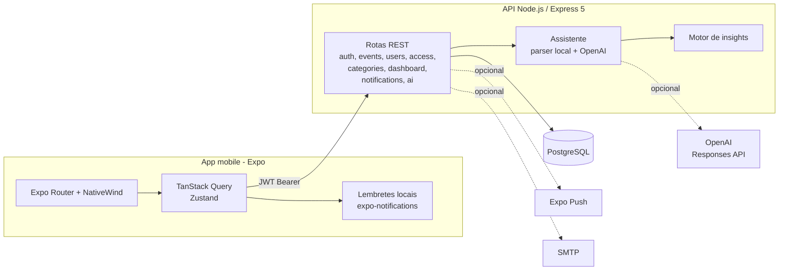

# Calendo — agenda compartilhada com assistente de IA

App mobile de agenda pessoal em que cada pessoa decide quem pode **ver** ou **editar** a sua agenda. O dono envia um convite por `@username`, com permissão de leitura ou edição e com prazo (ou permanente). Quem tem acesso vê a agenda do outro, cria compromissos nela (se puder editar), e tudo fica registrado num **histórico de atividades**. Um **assistente** em português entende pedidos como *"agendar reunião com Paulo amanhã às 15h sobre orçamento"*, pergunta o que falta, mostra uma prévia com conflitos de horário e só grava depois da confirmação.

> **Sobre esta versão.** Versão anonimizada de um sistema real que desenvolvi para uma empresa; nomes, marca, domínios, conteúdo proprietário e dados foram substituídos por fictícios. A arquitetura, as regras de negócio e o código são os do sistema real.

**English summary:** Shared-calendar mobile app (Expo SDK 54 + React Native 0.81 + Expo Router + NativeWind / Node.js + Express 5 + PostgreSQL). Users share their calendar by username with view or edit permission and optional expiry, through an invite → accept flow. Every change is written to an audit log, and invites and access changes trigger in-app and Expo push notifications. An AI assistant (OpenAI Responses API with strict JSON-schema structured output, plus a local rule-based Portuguese parser as fallback) turns natural-language requests into a draft event. It fills the draft slot by slot, detects conflicts and requires explicit confirmation before writing; pending actions expire after 30 minutes. It also includes local reminders, agenda insights (conflicts, tight gaps, busy days, next free slot), categories, password reset by e-mailed code, and an idempotent schema bootstrap. The API runs locally with `docker compose up`.

---

## Sumário

- [O que o app faz](#o-que-o-app-faz)
- [Arquitetura](#arquitetura)
- [Stack](#stack)
- [Rodar localmente](#rodar-localmente)
- [Contas de demonstração](#contas-de-demonstração)
- [Roteiro para testar](#roteiro-para-testar)
- [Integrações](#integrações)
- [O assistente](#o-assistente)
- [Segurança](#segurança)
- [Estrutura do repositório](#estrutura-do-repositório)
- [Variáveis de ambiente](#variáveis-de-ambiente)
- [Decisões técnicas](#decisões-técnicas)

---

## O que o app faz

### Agenda

| Área | O que faz |
|---|---|
| **Início** | Painel do dia: compromissos de hoje, próximo evento, contagem da semana e de lembretes ativos, convites pendentes, agendas compartilhadas comigo (com o próximo evento de cada uma), acessos que vencem em 7 dias, atividade recente e cards de insights. |
| **Calendário** | Faixa horizontal de dias e visão mensal com marcadores por cor de categoria. |
| **Eventos** | Criar, editar e excluir, com título, descrição, categoria, início e fim (inclusive eventos que atravessam dias) e lembrete com antecedência configurável. Tela de escolha de horário com prévia do intervalo. |
| **Categorias** | Categorias próprias com nome e cor (hex). Três categorias padrão são criadas no primeiro acesso. |
| **Lembretes** | Notificações locais agendadas no aparelho a partir dos eventos com lembrete, ressincronizados quando a agenda muda. |

### Compartilhamento

| Área | O que faz |
|---|---|
| **Convites** | O dono convida por `@username` com permissão `view` ou `edit`, permanente ou com data de validade. O convidado aceita ou recusa, e o dono pode cancelar um convite pendente. Convites vencidos expiram sozinhos. |
| **Acessos** | Lista de quem acessa a minha agenda (com revogação) e de quem compartilhou comigo. |
| **Agenda de outra pessoa** | Abre a agenda de alguém por `@username`. Uma agenda pública pode ser vista sem login. Uma agenda privada só abre com um acesso válido, e só quem tem `edit` cria, altera ou exclui eventos nela. |
| **Histórico** | Log de auditoria por agenda (quem criou, alterou ou removeu o quê, com os campos que mudaram). Convites, aceites e revogações também entram no log. |
| **Notificações** | Central de notificações no app (lidas e não lidas) e push pelo Expo para convites, aceites, recusas e revogações. Quando o dono altera a própria agenda, quem tem acesso a ela recebe uma notificação no app. |

### Assistente

- Chat em português com histórico de conversas e botão de "nova conversa".
- Cria eventos por linguagem natural, preenchendo um rascunho campo a campo com sugestões rápidas (chips).
- Remarca eventos existentes ("remarcar a retrospectiva para as 17h").
- Mostra uma prévia com os conflitos de horário e só grava depois da confirmação. A ação pendente expira em 30 minutos.
- Analisa a agenda: conflitos, trocas muito curtas entre compromissos, dias lotados, eventos sem descrição, lembretes desligados e o próximo horário livre.

### Conta

Cadastro, login, recuperação de senha por código enviado por e-mail, edição de perfil com foto, agenda pública ou privada, preferências de notificação e onboarding de três telas.

---

## Arquitetura



**Fluxo do assistente**

1. `POST /ai/chat` grava a mensagem na conversa atual e carrega os eventos dos próximos 30 dias e as categorias.
2. O parser local detecta a intenção (criar, remarcar, analisar). Se houver chave da OpenAI, a extração de campos usa saída estruturada com JSON Schema estrito, e o resultado é mesclado com o do parser local.
3. Enquanto faltar dado, o rascunho fica no `metadata` da conversa e o assistente pergunta o próximo campo, com sugestões.
4. Com o rascunho completo, a API valida as datas, calcula os conflitos e grava uma `ai_action_run` pendente (validade de 30 minutos).
5. `POST /ai/actions/:id/confirm` confere o dono, o status e a validade, cria ou atualiza o evento, registra no histórico como "Assistente IA" e responde na conversa.

---

## Stack

**Mobile:** Expo SDK 54, React Native 0.81, React 19.1, Expo Router 6, TypeScript 5.9, NativeWind 4 (Tailwind), TanStack Query 5, Zustand 5 (sessão persistida no AsyncStorage), React Hook Form, Zod, Axios, date-fns, Reanimated 4, Gesture Handler, `@gorhom/bottom-sheet`, Lucide, expo-notifications, expo-image-picker.

**API:** Node.js 22, Express 5, PostgreSQL (`pg`), JWT (`jsonwebtoken`), bcryptjs, Nodemailer, OpenAI Responses API via `fetch`, Expo Push API via `fetch`, testes com `node:test`.

**Infra:** Dockerfile da API (Node 22 Alpine, roda sem root) e `docker-compose` para o ambiente local. O deploy de produção foi retirado deste repositório.

---

## Rodar localmente

### 1. API

#### Opção A: Docker (recomendado)

Pré-requisito: Docker Desktop.

```bash
git clone https://github.com/vitormouramaker/shared-calendar-ai.git
cd shared-calendar-ai
docker compose up --build
```

- API: http://localhost:4444/health
- PostgreSQL exposto em `localhost:5434` (usuário e senha `postgres`)

Na subida, o compose cria as tabelas e as [contas de demonstração](#contas-de-demonstração). Para ligar a IA da OpenAI (opcional):

```bash
OPENAI_API_KEY=sk-... docker compose up --build
```

#### Opção B: sem Docker

Pré-requisitos: Node.js 20+ (testado com 22) e PostgreSQL 14+.

```bash
cd backend
cp .env.example .env          # ajuste DB_USER / DB_PASSWORD / DB_PORT se precisar
npm install
npm run db:init               # cria o banco calendo e as tabelas
npm run seed:demo             # contas de demonstração (senha Demo@123)
npm run dev                   # http://localhost:4444
```

### 2. App mobile

```bash
cd mobile
npm install
npx expo start --go        # Expo Go (o projeto também tem expo-dev-client)
```

- **Expo Go** (celular na mesma rede Wi-Fi): leia o QR code. O app descobre a API sozinho pelo IP do Metro, na porta 4444. No Expo Go o push remoto não funciona, mas os lembretes locais sim.
- **Emulador Android:** tecla `a`. O app tenta `10.0.2.2:4444`, que é o localhost da máquina visto de dentro do emulador.
- **Simulador iOS:** tecla `i` (precisa de macOS).
- **Development build** (necessário para testar push remoto): `npx expo run:android` ou `npx expo run:ios`, com `EAS_PROJECT_ID` e os arquivos do Firebase da sua conta (veja [Variáveis de ambiente](#variáveis-de-ambiente)).

Se a API estiver em outro endereço, crie `mobile/.env` com `EXPO_PUBLIC_API_URL=http://SEU_IP:4444` (veja `mobile/.env.example`). O app testa os endereços candidatos em ordem e guarda o primeiro que responde.

### Sem chaves externas, tudo funciona

| Sem... | Comportamento |
|---|---|
| `OPENAI_API_KEY` | O assistente usa o interpretador local em português (datas como "hoje", "amanhã", "depois de amanhã" e `dd/mm`, horários como "15h" e "14:30", durações, categorias, "mesmo dia", "sem descrição", "cancelar"). |
| SMTP | O código de recuperação de senha aparece no console da API (só fora de produção). |
| Projeto EAS / Firebase | O app não registra token de push remoto. Os lembretes locais e a central de notificações continuam funcionando. |

---

## Contas de demonstração

Criadas por `npm run seed:demo` (ou automaticamente no Docker). Senha de todas: **`Demo@123`**. As contas existem só no seu banco local, e o script se recusa a rodar com `NODE_ENV=production`.

| Conta | E-mail | Cenário |
|---|---|---|
| Ana (agenda privada) | `ana@demo.calendo.test` | Semana cheia, com um conflito de horário amanhã. Compartilha a agenda com o Bruno (edição). Tem um convite pendente do Bruno. |
| Bruno (agenda privada) | `bruno@demo.calendo.test` | Pode editar a agenda da Ana. Convidou a Ana para ver a dele. |
| Carla (agenda pública) | `carla@demo.calendo.test` | Agenda aberta: dá para ver `@carla` sem login. |

Rodar o seed de novo apaga e recria só essas três contas, com os eventos relativos ao dia de hoje.

## Roteiro para testar

1. Entre como **ana**. O início mostra os compromissos de hoje e os insights (por exemplo, o "Conflito entre eventos" de amanhã).
2. Na aba do assistente, escreva *"agendar reunião com Paulo amanhã às 15h sobre orçamento"*. Responda às perguntas (categoria, término, lembrete), confira a prévia e confirme. O evento aparece no calendário e no histórico como "Assistente IA".
3. Escreva *"analise minha semana"* para ver o resumo da agenda, e *"remarcar a retrospectiva para as 17h"* para ver a prévia de uma remarcação.
4. Em Perfil → Convites recebidos, aceite o convite do Bruno e abra a agenda `@bruno`.
5. Entre como **bruno** (outro aparelho ou depois de sair), abra `@ana` e crie um evento na agenda dela. A Ana recebe a atividade no histórico.
6. Como **ana**, em Perfil → Acessos, revogue o acesso do Bruno. Ao tentar abrir `@ana` de novo, o Bruno recebe "Esta agenda é privada".
7. Saia e use "Esqueci a senha" com `carla@demo.calendo.test`. O código aparece no console da API.

---

## Integrações

### OpenAI (opcional)
- `backend/src/services/openai.js` chama a **Responses API** com `text.format = json_schema` e `strict: true`. São dois schemas: a extração de campos do rascunho e a classificação de intenção (criar, remarcar, analisar, outro) com os dados da ação.
- Qualquer falha (sem chave, erro HTTP) cai no caminho local sem quebrar a conversa. O provedor e o modelo usados ficam gravados em cada `ai_action_run`.

### Expo Push (opcional)
- O app registra o token Expo do aparelho em `POST /users/me/push-tokens` (um usuário pode ter vários aparelhos).
- A API envia em lotes de 100 para `exp.host` e remove tokens que voltam como `DeviceNotRegistered`.
- O push respeita as preferências do usuário (`notify_push_enabled`, `notify_share_updates`).

### E-mail (opcional)
- Código de recuperação de senha por SMTP (Nodemailer). O código é de uso único, preso à conta e vale 15 minutos.

---

## O assistente

Implementado em [`backend/src/services/ai-assistant.js`](backend/src/services/ai-assistant.js), com os insights em [`ai-insights.js`](backend/src/services/ai-insights.js).

- **Híbrido local + LLM:** o parser por regras resolve sozinho os casos comuns. O LLM, quando configurado, só complementa a extração e nunca grava nada direto.
- **Rascunho com estado:** o rascunho mora no `metadata` JSONB da conversa, então sobrevive entre mensagens e reinícios. A cada resposta, o assistente pergunta o próximo campo que falta, numa ordem fixa, e oferece sugestões contextuais.
- **Humano no circuito:** criar ou remarcar gera uma prévia (com conflitos e o evento original, no caso de remarcação) que precisa ser confirmada. A confirmação confere o dono, o status `pending` e a validade.
- **Auditoria:** cada ação confirmada vai para o histórico da agenda com `source: assistant_ai` e o pedido original.
- **Insights determinísticos:** conflitos, trocas com menos de 15 minutos, dias com 5 ou mais eventos ou 4h ou mais de compromissos, eventos sem descrição, lembretes desligados e o próximo horário livre dentro do expediente (8h–18h). Tudo é calculado em código, sem depender do LLM.

Os prompts do LLM são instruções curtas de extração e ficam no próprio código.

---

## Segurança

- Senhas com bcrypt. JWT com validade de 12h. Em produção a API não sobe sem `JWT_SECRET`.
- Recuperação de senha: código de 6 dígitos gerado com `crypto.randomInt`, guardado só como hash, preso ao usuário, de uso único e válido por 15 minutos. Pedir um código novo invalida o anterior, e o código é anulado depois de 5 tentativas erradas.
- Rate limit em memória no login, no cadastro, no "esqueci a senha" e na redefinição.
- Toda consulta usa parâmetros (`$1`, `$2`...), sem SQL montado com texto do usuário.
- As consultas de evento, categoria, notificação, conversa e ação da IA sempre filtram pelo dono (`user_id`). As rotas de agenda de terceiros conferem o acesso, a validade e o nível de permissão a cada requisição.
- O "esqueci a senha" responde igual para e-mails existentes e inexistentes.
- Mensagens de erro genéricas para o cliente. O detalhe fica só no log do servidor.

---

## Estrutura do repositório

```
shared-calendar-ai/
├── docker-compose.yml        # PostgreSQL + API para rodar local
├── backend/
│   ├── database.sql          # schema base (aplicado também na subida)
│   ├── src/
│   │   ├── app.js            # bootstrap, rotas e /health
│   │   ├── routes/           # auth, events, users (agenda de terceiros),
│   │   │                     # access (convites/acessos), categories,
│   │   │                     # dashboard, notifications, ai
│   │   ├── services/         # execute (acesso a dados), ai-assistant,
│   │   │                     # ai-insights, openai
│   │   ├── models/           # SQL parametrizado
│   │   ├── middleware/       # auth (JWT) e rate limit
│   │   ├── security/         # hash de senha e JWT
│   │   ├── server/           # conexão, schema idempotente, e-mail, push
│   │   └── utils/            # respostas padrão e diff para o histórico
│   ├── scripts/              # init do banco e seed de demonstração
│   └── test/                 # testes do assistente e dos insights
└── mobile/
    ├── app/                  # telas (Expo Router): (tabs), auth, event,
    │                         # agenda, profile, assistant, notifications
    ├── src/
    │   ├── hooks/            # TanStack Query por domínio
    │   ├── lib/              # axios com descoberta da API, lembretes, push
    │   ├── store/            # Zustand (sessão, diálogos, rascunho de evento)
    │   └── components/       # calendário, cards e UI base
    ├── scripts/              # gerador dos ícones neutros
    └── app.config.js         # ids de EAS/Firebase vindos do ambiente
```

---

## Variáveis de ambiente

### API (`backend/.env.example`)

| Variável | Para quê | Obrigatória localmente |
|---|---|---|
| `DB_HOST`, `DB_PORT`, `DB_NAME`, `DB_USER`, `DB_PASSWORD` | Conexão com o PostgreSQL | sim (o exemplo já funciona) |
| `DB_TIMEZONE` | Fuso da sessão do banco ("hoje", "esta semana") | não (padrão `America/Sao_Paulo`) |
| `JWT_SECRET` | Assinatura dos tokens | não localmente; **obrigatória em produção** |
| `PORT`, `HOST` | Porta e interface da API | não (padrão `4444`, `0.0.0.0`) |
| `CORS_ORIGINS` | Origens liberadas para clientes de navegador (o app nativo não usa CORS) | não |
| `APP_NAME` | Nome no remetente dos e-mails | não |
| `SMTP_HOST`, `SMTP_PORT`, `SMTP_SECURE`, `SMTP_USER`, `SMTP_PASS`, `SMTP_FROM` | Envio real do código de recuperação | não |
| `OPENAI_API_KEY`, `OPENAI_MODEL` | Liga a extração por LLM no assistente | não |

### App (`mobile/.env.example` e `mobile/app.config.js`)

| Variável | Para quê |
|---|---|
| `EXPO_PUBLIC_API_URL` | Endereço fixo da API (opcional: o app descobre sozinho em desenvolvimento) |
| `EXPO_PUBLIC_EAS_PROJECT_ID` ou `EAS_PROJECT_ID` | Projeto EAS, necessário para o token de push remoto |
| `EAS_OWNER`, `APP_BUNDLE_ID` | Dono do projeto EAS e identificador do app em builds próprios |
| `GOOGLE_SERVICES_JSON`, `GOOGLE_SERVICES_PLIST` | Caminhos dos arquivos do Firebase (FCM/APNs) da sua conta, para builds com push |

---

## Decisões técnicas

- **Schema idempotente na subida** (`server/ensure-schema.js`): aplica o `database.sql` e depois as colunas, tabelas, índices e constraints que chegaram com o tempo (`IF NOT EXISTS`, `DROP/ADD CONSTRAINT`). Um banco vazio e um banco antigo terminam no mesmo estado, sem ferramenta de migração.
- **Fuso no banco:** a conexão define `timezone` na sessão, então "hoje" e "esta semana" nas consultas do painel seguem o fuso configurado, e os timestamps ficam em `timestamptz`.
- **Convite → acesso em transação:** aceitar um convite cria ou atualiza o acesso e marca o convite numa única transação. Um índice único parcial impede dois convites pendentes para o mesmo par.
- **Histórico com diff:** a edição de evento grava só os campos que mudaram (antes e depois), formatados no fuso da agenda.
- **Descoberta da API no app:** em desenvolvimento o Axios tenta, em ordem, o host do Metro, `10.0.2.2` (emulador), `localhost` e a URL configurada, e fixa a primeira que responde. Assim o mesmo código roda em emulador, simulador e aparelho físico sem configuração.
- **Lembretes locais + push remoto:** o lembrete de evento é local (funciona offline e sem conta EAS). O push remoto fica para eventos sociais (convites e acessos).
- **Degradação elegante:** OpenAI, SMTP e push são opcionais. Sem eles o app continua completo, com caminhos locais.

---

Autor: [@vitormouramaker](https://github.com/vitormouramaker)

Este código é exibido como portfólio. Ele não tem licença de uso aberta: todos os direitos são reservados.
